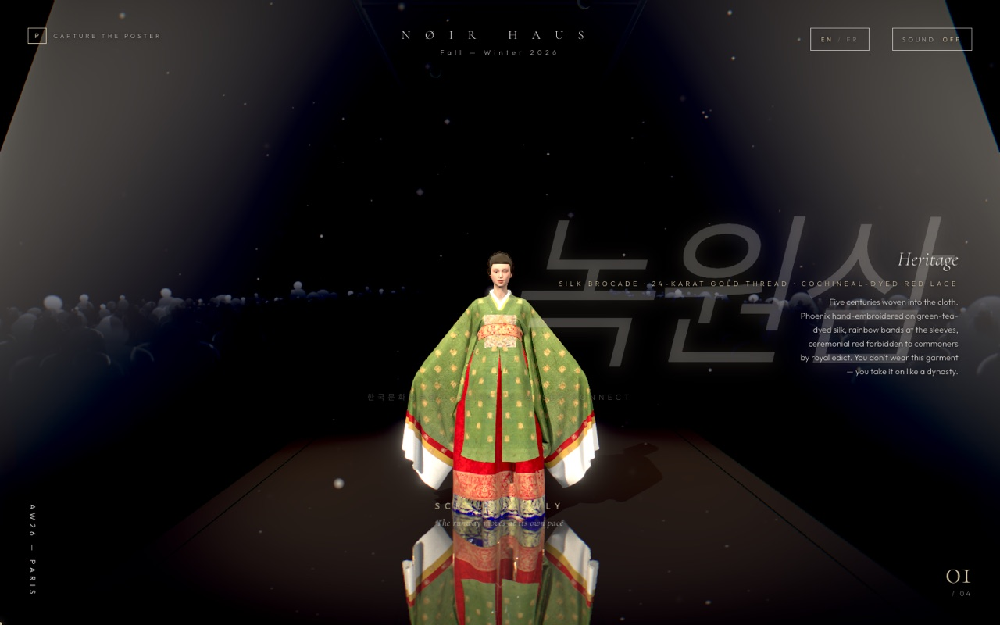
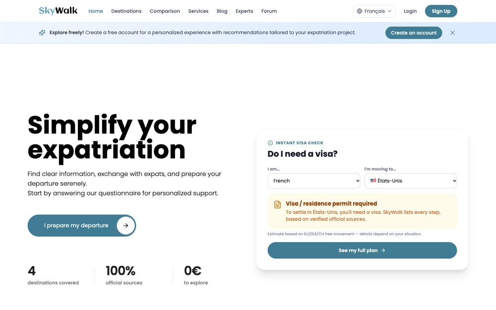
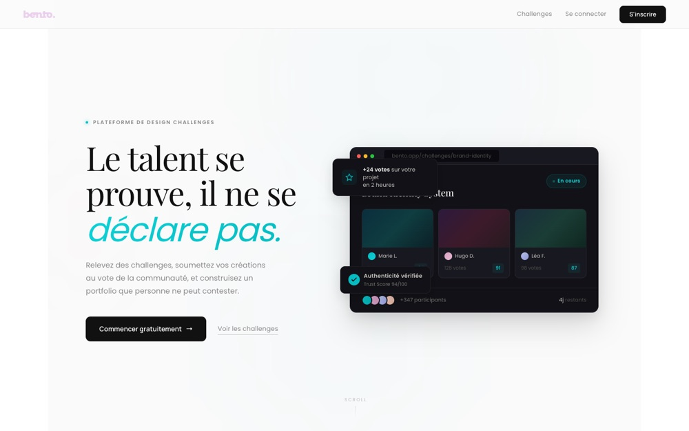
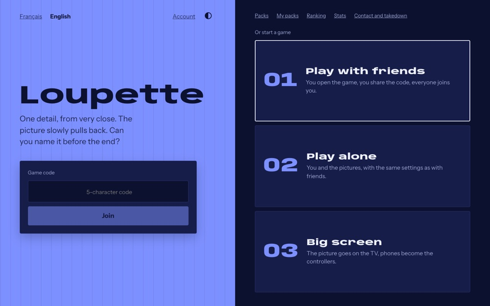
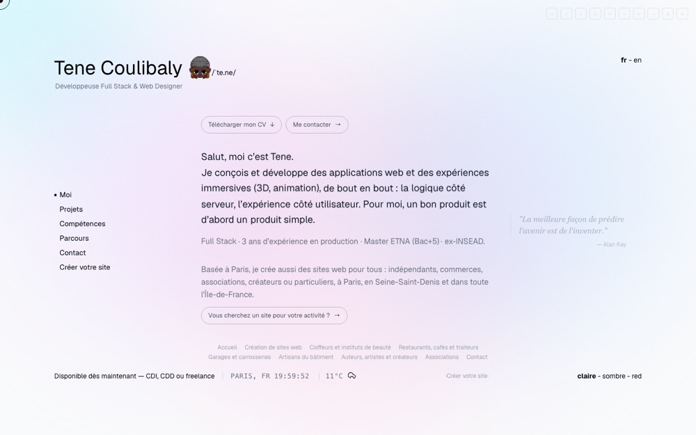

  
  
  

Je construis des produits de bout en bout, de l'architecture backend jusqu'au pixel : interfaces temps réel, intégrations d'API, web créatif en 3D. Je maquette sur Figma et je code moi-même.

Ces dernières années : **INSEAD** (plateformes d'admission et de bourses, portail Executive Education), **Captag** (calculateur d'empreinte carbone pour l'événementiel), **Sayse** (supervision réseau en temps réel). Master Architecte des SI à l'ETNA.

## Projets choisis

**[NØIR HAUS](https://github.com/CoulibalyT/noir)** · défilé de haute couture en 3D, en un seul plan-séquence piloté au scroll. GLSL sur mesure, post-traitement en 7 passes, son procédural. 
<code>Three.js</code> <code>TypeScript</code> <code>GSAP</code> <code>Web Audio</code>

<table>
  <tr>
    <td width="50%" valign="top">
      
       <b><a href="https://github.com/CoulibalyT/skywalk">SkyWalk</a></b> · plateforme d'aide à l'expatriation
       24 modules backend, 110+ endpoints, 8 API externes, forum modéré par IA, CI/CD, tests E2E
       <code>React 19</code> <code>NestJS</code> <code>PostgreSQL</code> <code>Docker</code>
    </td>
    <td width="50%" valign="top">
      
       <b><a href="https://bento-sable.vercel.app">Bento</a></b> · défis créatifs pour designers
       votes et classements en temps réel, détection anti-IA, plugin Figma
       <code>Vue 3</code> <code>NestJS</code> <code>Prisma</code> <code>Socket.io</code>
    </td>
  </tr>
  <tr>
    <td width="50%" valign="top">
      
       <b><a href="https://github.com/CoulibalyT/closeup">Loupette</a></b> · jeu de soirée multijoueur
       une image en très gros plan se dézoome, le premier qui devine gagne
       <code>Nuxt</code> <code>NestJS</code> <code>Socket.io</code> <code>PostgreSQL</code> <code>Redis</code>
    </td>
    <td width="50%" valign="top">
      
       <b><a href="https://github.com/CoulibalyT/PortfolioV2">Portfolio</a></b> · tenecoulibaly.fr
       bilingue, thèmes clair, sombre et rouge, captures générées par Portfolio Sync
       <code>Vue 3</code> <code>GSAP</code> <code>Three.js</code> <code>Tailwind</code>
    </td>
  </tr>
</table>

**[Portfolio Sync](https://github.com/CoulibalyT/portfolio-sync)** · CLI npm qui capture et optimise automatiquement des captures d'écran de projets en ligne. <code>Node.js</code> <code>Puppeteer</code> <code>Sharp</code>

## Stack

Aussi : SQL Server, Playwright, Socket.io, GSAP, Salesforce (LWC, Apex), SSO SAML 2.0 et Microsoft Entra ID.

## Activité

<picture>
  <source media="(prefers-color-scheme: dark)" srcset="https://raw.githubusercontent.com/CoulibalyT/CoulibalyT/output/snake-dark.svg">
  <source media="(prefers-color-scheme: light)" srcset="https://raw.githubusercontent.com/CoulibalyT/CoulibalyT/output/snake-light.svg">
  
</picture>

## En ce moment

- Je cherche un CDI ou une mission dans une équipe produit où design et code avancent ensemble.
- J'explore le RAG et les agents.
